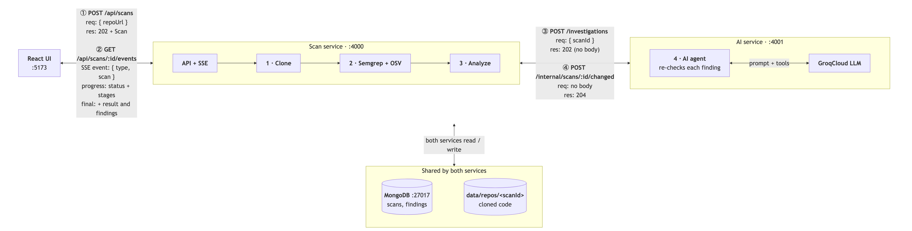
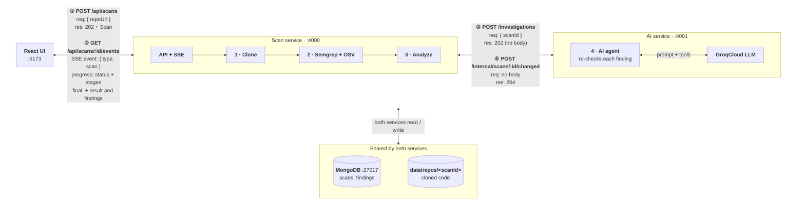

# How AI Scan Review works

1. **React UI** sends the GitHub URL to the scan service (`POST /api/scans`) and follows the scan over Server-Sent Events.
2. **Scan service** (port 4000) creates the scan, answers right away, and runs three steps in the background:
   1. **Clone**: a shallow, read-only copy of the repository into `server/data/repos/<scanId>/`.
   2. **Scan**: Semgrep finds risky code; OSV-Scanner finds packages with known CVEs and whether each is direct or indirect.
   3. **Analyze**: removes duplicates, groups related hits, and gives each finding a risk score and a priority (Fix now, Fix soon, Monitor).
3. **Handoff**: the scan service saves the analyzed result to MongoDB and calls the AI service with the scan ID (`POST /investigations`, answered with `202`).
4. **AI service** (port 4001, localhost only) reads the findings from MongoDB and the code from the shared folder. For each finding, the LLM reads the real code through read-only tools, checks reachability and the data flow, and suggests a new rating and a code fix. The backend applies a change only if the evidence checks out.
5. **Live updates**: every change the AI service saves, it reports to the scan service (`POST /internal/scans/:id/changed`), which pushes the scan to the UI. Progress events carry only the status and stages; the result and findings are sent once, in the final event. The UI talks only to the scan service.

**Why two services.** The AI step is slow and rate-limited; clone, scan and analyze are fast. Split, each can be restarted and scaled on its own, and if the AI service is down, scans still finish with the scanner ratings. They share the clone folder, so today they run on one machine; in production that becomes a re-clone of the same commit (or S3), plus a job queue.

**Why MongoDB.** SQLite was a file, so both services had to sit next to it. MongoDB is a server on its own port (27017, `MONGODB_URL`), so the scan service, the AI service and the database can each run on a different machine. Each finding is its own flexible document, so new fields need no schema change, and cross-repo questions ("which repos have CVE-X") are one indexed query. All database code sits in one file behind the `ScanStore` interface; tests run on an in-memory MongoDB.

Diagram source (Mermaid). After editing it, regenerate the image with: <code>npx -y @mermaid-js/mermaid-cli@11 -i diagram.mmd -o docs/architecture.png -b white -w 2000 -s 2</code>

