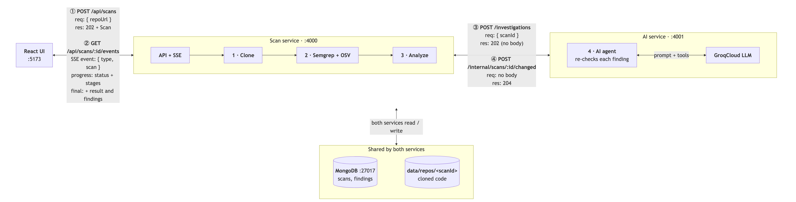

# AI Scan Review

> "I don't want a raw scanner report. I want to understand what matters, what is risky, and what I should do next."

AI Scan Review scans a public GitHub repository and turns the security findings into a short decision list:

- **What matters**: a risk grade (A–F), a headline and a short summary.
- **What is risky**: each finding has a severity, a context-adjusted risk score (0–100) and a priority (**Fix now**, **Fix soon**, **Monitor**), with the reasons shown.
- **What to do next**: ranked actions, where one action can fix many findings (e.g. "Upgrade lodash to 4.18.0 – resolves 4 vulnerabilities").

Two open-source scanners find the issues: [Semgrep](https://semgrep.dev) for risky code and hard-coded secrets (`p/default`, `p/secrets` and packs for JavaScript, TypeScript, Node.js, Express, Python, Java, Go, C#, PHP and Ruby), and [OSV-Scanner](https://google.github.io/osv-scanner/) for known CVEs in dependencies of every language it supports. The backend then groups, scores and prioritizes the results. An optional AI agent re-checks every finding in the real code and may re-rate it, but only with evidence the backend verifies.

## How to run

Works on macOS and Linux. On Windows, run everything inside [WSL 2](https://learn.microsoft.com/windows/wsl/install) (Ubuntu), because the scanners are command-line tools built for Unix shells; the steps below are then the Linux ones.

**Prerequisites** (install once per machine):

| Tool | Version | How to install |
|---|---|---|
| [Node.js](https://nodejs.org) | ≥ 22.13 | Installer from nodejs.org, or `nvm install 22` |
| [git](https://git-scm.com/downloads) | any | Usually already installed |
| [Semgrep](https://semgrep.dev/docs/getting-started/) | 1.x | `pipx install semgrep` (or `pip install semgrep`); macOS: `brew install semgrep` |
| [OSV-Scanner](https://google.github.io/osv-scanner/installation/) | 2.x | Download the binary for your OS from the [releases page](https://github.com/google/osv-scanner/releases) and put it on your `PATH`; macOS: `brew install osv-scanner`; with Go: `go install github.com/google/osv-scanner/v2/cmd/osv-scanner@latest` |
| [MongoDB](https://www.mongodb.com/docs/manual/installation/) | 6+ | Docker (below), or a local install |

Check them with `node --version`, `semgrep --version` and `osv-scanner --version`.

**1. Get the code**

```bash
git clone https://github.com/nassar151/ai-scan-review.git
cd ai-scan-review
```

**2. Start MongoDB** (once)

Easiest on any OS, with [Docker](https://docs.docker.com/get-docker/):

```bash
docker run -d --name ai-scan-mongo -p 27017:27017 mongo:7
```

Or with a local install (macOS: `brew tap mongodb/brew && brew install mongodb-community && brew services start mongodb-community`). The default `MONGODB_URL` is `mongodb://127.0.0.1:27017/ai_scan_review`; both services create the database and its indexes at startup.

**3. Install the dependencies and configure**

```bash
npm install
cp .env.example .env
```

Edit `.env`: set `MONGODB_URL` if needed (step 2). The AI step is optional. To turn it on, put a free [GroqCloud key](https://console.groq.com/keys) in `.env` as `AI_API_KEY` (xAI and OpenAI also work, see `.env.example`). Without a key, scans still run with the scanner ratings and the AI step is skipped.

**4. Start**

```bash
npm run dev
```

This starts the scan service on `:4000`, the AI service on `127.0.0.1:4001` and the UI on **http://localhost:5173**. Open the UI, paste a public GitHub URL (for example `https://github.com/OWASP/NodeGoat`, or one of the "Try" examples) and click **Start scan**. You can go back to the home page while a scan runs and reopen it from "Recent scans".

**Checks:** `npm run typecheck`, `npm test` (106 server tests on an in-memory MongoDB started by the tests, so no database server is needed; the first run downloads the MongoDB binary; the integration test is skipped if the scanners are missing), `npm run build`.

**Demo repos to scan** (intentionally vulnerable, with the expected results in each README):

- [nassar151/ai-scan-nine](https://github.com/nassar151/ai-scan-nine): 9 findings (4 code, 1 secret, 4 packages); everything is reachable except lodash.
- [nassar151/ai-scan-reach](https://github.com/nassar151/ai-scan-reach): 6 findings, including code in a router that is never mounted, so it is not reachable (and not a false positive), and findings with 2 appearances.
- [nassar151/ai-scan-big](https://github.com/nassar151/ai-scan-big): 14 findings (6 code, 1 secret, 7 packages, 3 of them through express), mixing reachable and not reachable.
- [nassar151/ai-scan-polyglot](https://github.com/nassar151/ai-scan-polyglot): 8 findings in Python and Java (4 code, 4 packages from `requirements.txt` and `pom.xml`), half reachable (SQL injection, deserialization, Log4j, PyYAML) and half not (unused command helpers, an unused XML parser, Pillow, snakeyaml).

## How it works

See [ARCHITECTURE.md](ARCHITECTURE.md) for the diagram and [docs/design-walkthrough.md](docs/design-walkthrough.md) for a file-by-file walkthrough.



**Project layout.** Each service has its own folder, and the code both use sits in `common/`. `common/` never imports from a service, and the two services never import from each other.

```
web/                    React UI (Vite, Bear UI, TanStack Query)
shared/                 Types and constants used by the UI and the server
server/src/
  scan-service/         Port 4000: public API + SSE (routes), pipeline, clone (repo, github),
                        scanners (Semgrep, OSV-Scanner), dependency graphs (deps)
  ai-service/           Port 4001, localhost only: the agent (investigation), LLM client (llm),
                        HTTP app, runner and change notifier (service)
  common/               Used by both: MongoDB (db, store), scan state (scans), analysis and scoring,
                        clone folder helpers (repo), HTTP errors (http), config, utils
server/test/            Unit, API and real-scanner integration tests
```

Two services sharing one MongoDB database and the clone folder `server/data/repos/<scanId>/`:

1. **Scan service** (port 4000) takes `POST /api/scans`, answers `202`, and in the background clones the repo (shallow, hooks off, size-checked), runs Semgrep and OSV-Scanner, and analyzes the results. It streams every change to the UI over Server-Sent Events.
2. **Handoff**: it saves the analyzed result and calls the AI service with `POST /investigations { scanId }`.
3. **AI service** (port 4001, localhost only) reads the findings from MongoDB and the code from the shared folder, runs the agent on every finding, saves the final result and deletes the clone. After each change it calls `POST /internal/scans/:id/changed`, and the scan service pushes the update to the UI.

**AI agent.** One run per finding, with three read-only tools over the clone (`search_code`, `read_file`, `list_files`). It checks reachability, traces the data flow from source to sink with example values, and returns strict JSON with a new rating, a reason and an optional code fix. Guardrails: every evidence item is checked against the real repo, a rating changes only with verified evidence and a stated reason (a new risk score always shows why it moved), the original rating stays visible, priority always comes from the backend thresholds, secrets are masked, and repository text is treated as untrusted. Provider: GroqCloud (`openai/gpt-oss-120b`) by default, or xAI or OpenAI through `.env`.

**Storage.** MongoDB (`MONGODB_URL`, default `127.0.0.1:27017/ai_scan_review`) with two collections: `scans` (one document per scan: status and stages, updated after every step, plus a `result` object with the grade, summary, next actions and counts, missing until the analysis finishes) and `findings` (one document per finding, with its `scanId`). The result and findings are written twice: by the scan service after analysis, then rewritten by the AI service when it finishes, with the AI ratings and a recomputed grade, risk score, headline, counts and next actions. While the AI runs, only the scan document's status and stages change.

**API.** `POST /api/scans`, `GET /api/scans`, `GET /api/scans/:id`, `GET /api/scans/:id/events` (SSE).

**What each call sends and returns** (the numbers match the diagram):

| # | Call | Request | Response |
|---|---|---|---|
| ① | UI → scan service: `POST /api/scans` | `{ repoUrl }` | `202` right away with a `Location: /api/scans/<id>` header and the new `Scan` as it was just saved (example below); the pipeline runs in the background |
| ② | UI → scan service: `GET /api/scans/:id/events` (SSE) | none | A stream of `{ type, scan }` events: one `snapshot` with the current state, then an `update` after every change. While the scan runs, events carry only the status and stages (about 1 KB); the result and findings are sent once, in the final event. It closes when the scan is `completed` or `failed` |
| ③ | Scan service → AI service: `POST /investigations` | `{ scanId }` | `202` right away, no body; the AI runs in the background. `400` for a bad id, `404` if the scan has no result. No answer within 5 s means the scan finishes without AI |
| ④ | AI service → scan service: `POST /internal/scans/:id/changed` | no body (localhost only) | `204`. Sent after every AI save; the scan service re-reads the scan from MongoDB and pushes it as event ② |

Example `202` body from ①: the scan is `queued`, every stage is `pending` and there is no `result` yet. The UI uses the `id` to open `/scans/:id` and the SSE stream ②.

```json
{
  "id": "d1ebf514-7c2a-4f0e-9b1d-3a6e5f2c8b40",
  "repo": { "owner": "nassar151", "name": "ai-scan-demo", "url": "https://github.com/nassar151/ai-scan-demo" },
  "status": "queued",
  "stages": [
    { "status": "cloning", "label": "Fetching repository", "state": "pending" },
    { "status": "scanning_code", "label": "Scanning source code", "state": "pending" },
    { "status": "scanning_dependencies", "label": "Checking dependencies", "state": "pending" },
    { "status": "analyzing", "label": "Analyzing risk", "state": "pending" },
    { "status": "investigating", "label": "AI investigation", "state": "pending" }
  ],
  "createdAt": "2026-11-24T08:10:00.000Z",
  "updatedAt": "2026-11-24T08:10:00.000Z"
}
```

## Product decisions

- **Decisions, not a report.** The page reads top to bottom: grade and headline, severity counts, the prioritized findings table, then ranked actions. Raw scanner details stay behind **More details**.
- **Actions grouped by the fix you apply.** One upgrade often resolves many CVEs, so it's one action instead of many rows.
- **Context changes the risk.** Dev-only, test-only, direct or indirect, and reachable or not all move the score, and the UI shows each factor.
- **Reachability as proof.** The AI shows an attack path (attacker → source → sink, with file:line and an example value) so the user can trust or challenge the rating.
- **One page per scan.** `/scans/:id` shows live progress and turns into the result at the same URL, so a refresh or a shared link always works.

## Technical decisions

- **Deterministic first, AI second, with proof.** The first rating is reproducible and tested; the AI can only change it with evidence the backend verifies, so a guessing model can't hide a critical issue.
- **Two services: scan and AI.** The AI step is slow and rate-limited; clone, scan and analyze are fast. Split, each can be restarted and scaled on its own, and if the AI service is down, scans still finish with the scanner ratings ("AI service unavailable"). They talk over plain HTTP and pass only scan IDs; the data is read from the shared MongoDB database and the shared clone folder.
- **Asynchronous handoff to the AI service.** `POST /investigations` only hands over the scan ID and gets `202` in milliseconds (the scan service gives up after 5 s and finishes without AI). The AI service then works in the background, saves its progress to MongoDB after each finding and the final result at the end, and pings the scan service (`POST /internal/scans/:id/changed`, answered `204`) so the UI is updated. A single long request that waits for the whole investigation would not block Node (it is just an `await`), but it is fragile: an investigation can take minutes, so proxies and clients would time it out, a dropped connection or a restart would lose the result and leave the scan stuck, there would be no progress to show, and a retry could start the same work twice. With the handoff, the scanner result and the progress live in the database, so a restart of one service never loses the other's work. The cost is one small ping per saved change (about the number of findings + 4); at scale these pings can be throttled or replaced by MongoDB change streams.
- **MongoDB, moved from SQLite and then Postgres.** SQLite is a file, so both services had to run next to it; a database server on its own port lets each service and the database run on a different machine. MongoDB stores each finding as a flexible document, so new fields (like the AI investigation) need no schema change, and one finding per document keeps cross-repo questions ("which repos have CVE-X") a single indexed query. All database code is in one file behind the `ScanStore` interface; the store is async, so changes to one scan are queued and saved in order.
- **Production path.** On separate machines: re-cloning the same commit SHA (or S3) instead of the shared folder, and a job queue (BullMQ or RabbitMQ) instead of direct HTTP, for retries and a concurrency limit.
- **Consistent results without transactions.** A re-saved result writes its findings under a new version first, then switches the scan to that version in one update, then deletes the old ones, so a reader never sees half a result.
- **Server-Sent Events.** Updates flow one way, from server to UI. Each event carries the scan state, so the UI writes it straight into the TanStack Query cache; progress events leave out the result and findings, which come once, in the final event, so a scan with many findings does not resend them on every update. It falls back to polling if the stream drops.
- **Scanners as CLI processes.** Semgrep, OSV-Scanner and `git` run as child processes (no shell, timeouts, output caps) and return JSON. Repository code is never executed.
- **Several scans can run at once.** The heavy work runs in child processes (git, Semgrep, OSV-Scanner) and network calls (the LLM), so Node's event loop serves several scans in parallel. Each running scan appears in "Recent scans" and can be opened at any time. At scale I'd add a queue with a cap on running scans and on LLM calls, because the free LLM tier has a rate limit.

**Next steps**: static call-graph reachability as extra evidence, full dependency trees for more lockfile formats, private repos through a GitHub App, diffs between scans, SARIF or Jira export.

## How coding agents were used

I built this with Cursor's agent as a pair programmer:

1. **Plan first.** The agent proposed a step-by-step plan from my design (scanners, analysis, AI, pipeline, storage, UI), and I approved each step before it wrote code.
2. **Decisions stayed with me**: the LLM provider, the storage (SQLite first, then Postgres, then MongoDB), parallel scans (one at a time at first), the fields each finding must show, and later the split into two services.
3. **Verified on real data.** The agent ran the real scanners on a fixture app, OWASP NodeGoat and `anxolerd/dvpwa`, and drove the UI in a browser. The results led to fixes, such as wrong titles, path mismatches on macOS and Semgrep skipping `fixtures/`.
4. **A purpose-built test repo**, [nassar151/ai-scan-demo](https://github.com/nassar151/ai-scan-demo), with known answers (reachable, unused, indirect and dev-only vulnerable packages, SQL injection, a hard-coded secret). It showed that Semgrep missed the Express SQL injection (fixed with `p/expressjs`) and that the UI didn't show direct or indirect dependencies (fixed with pills).
5. **Guardrails.** Workspace rules kept the code consistent (types and constants in their own files, Bear UI, TanStack Query), and `npm audit` issues were fixed by upgrading.
6. **Understanding the design.** I used the agent to walk me through the code file by file, recorded in [docs/design-walkthrough.md](docs/design-walkthrough.md).
